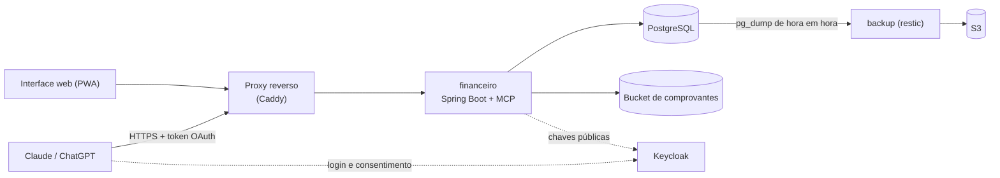
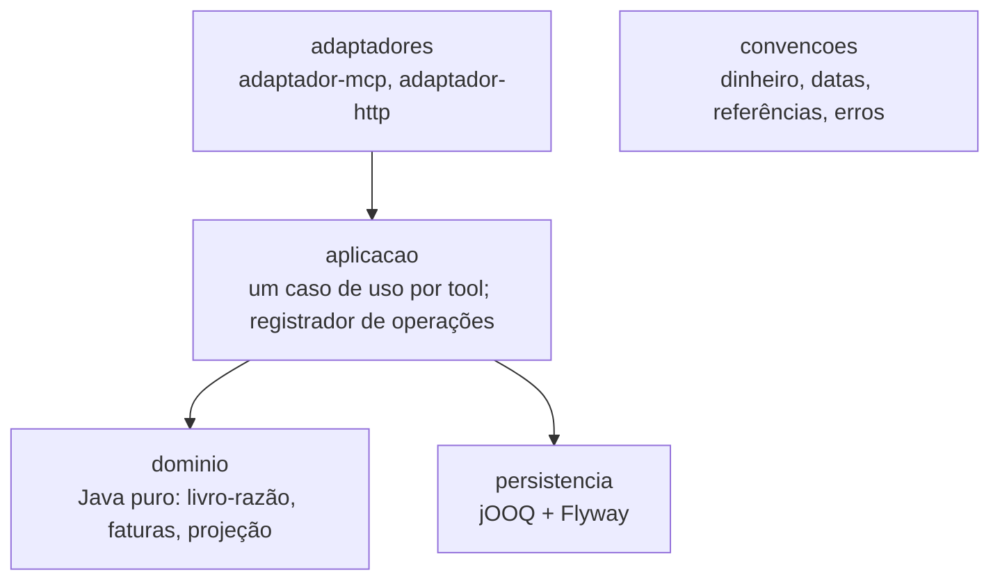

# Alicerce Finanças

**Controle financeiro pessoal por conversa: você fala com o Claude ou o ChatGPT, e o Alicerce guarda os fatos e faz as contas.**

> "Gastei 45 no almoço, no débito."
> "Comprei uma TV de 2.400 em 10x no cartão."
> "O que eu preciso cortar para fechar o mês no verde?"

Planilha dá trabalho e app de finanças pede que você se adapte a ele. O Alicerce faz o contrário. Você conversa com o assistente de IA que já usa, manda o print do Pix ou a foto da nota fiscal, e ele registra tudo num servidor [MCP](https://modelcontextprotocol.io) com regras de contabilidade de verdade.

A regra principal do projeto é simples: **o assistente pensa; o servidor registra, calcula e prova.** Nenhum número sai da IA. Saldos, totais, projeções e cortes vêm de cálculos determinísticos sobre o banco de dados, e o assistente só interpreta o resultado.

## O que dá para fazer

| Você pergunta ou envia | O Alicerce faz |
| --- | --- |
| "Gastei 45 no almoço, débito", um print do Pix, a foto da nota | Registra o gasto padronizado, com itens e chave da NFC-e. Se faltar algum dado, recusa e pergunta em vez de chutar. |
| "Comprei em 10x no cartão" | Lança as parcelas nas faturas certas, conforme o dia de fechamento e de vencimento do cartão |
| "Quanto gastei e quanto ganhei em setembro?" | Resumo de qualquer período, por competência ou por caixa |
| "Estou gastando mais rápido que o normal?" | Compara o ritmo do mês com o seu típico e mostra quais categorias puxam a diferença |
| "O que preciso deixar de gastar para fechar o mês no verde?" | Projeta o saldo do fim do mês e sugere um plano mínimo de cortes por categoria |
| "Como fica meu saldo nos próximos meses se eu fizer essa viagem?" | Projeção mês a mês, com a linha de base e até três cenários |
| "Quero juntar 8 mil para a viagem até julho" | Meta de valor com conta reservada: mostra quanto falta e quanto aportar por mês |
| "Minha reserva de emergência é de 6 meses de gastos" | Regras do perfil (reserva mínima, teto de parcelas, intenção de poupança) que o servidor vigia e avisa quando estão em risco |
| "O aluguel vence todo dia 10" | Compromissos a pagar e a receber, com agenda do que vence |
| "Confere o saldo do Nubank: está 1.234,56" | Confere o saldo informado contra o livro-razão e aponta a diferença e os lançamentos candidatos |
| "Quanto gastei com a família este ano?" | Âmbitos (pessoal, família, igreja, empresa…) e um link de prestação de contas que abre sem login |
| "Desfaz isso." | Toda escrita vira uma operação que pode ser desfeita, sem apagar nada |

Também funciona com conta em moeda estrangeira (o câmbio entra como o extrato mostra) e com comprovantes e fotos anexados aos lançamentos.

## Por que confiar nos números

- **Livro-razão de partidas dobradas, imutável.** Todo lançamento soma zero dentro de cada moeda, e o banco garante isso no commit. Corrigir vira estorno: nada é editado nem apagado.
- **Dinheiro como dinheiro.** `BigDecimal` com duas casas no domínio e centavos inteiros no banco. Nunca `double`.
- **Desfazer de verdade.** Toda escrita passa por um registrador de operações que guarda cada efeito. Desfazer gera a operação inversa, e a trilha de auditoria mostra tudo, inclusive as tentativas recusadas.
- **Idempotência.** Se o assistente repetir uma chamada (acontece!), o gasto não é registrado duas vezes.
- **Sem alucinação de saldo.** O assistente recebe os números prontos e é instruído a nunca somar nem recalcular por conta própria.

## Privacidade e segurança

- **Login OAuth 2.1**, conforme a especificação do MCP, com um Keycloak próprio. O servidor publica os metadados do recurso (RFC 9728) e confere assinatura, emissor, audiência, validade, cliente, papel do dono e escopo exigido por tool.
- **Escopos separados:** ler (`fin:read`), registrar (`fin:write`), mexer na estrutura (`fin:structure`), no perfil (`fin:profile`) e compartilhar (`fin:share`). O assistente só faz o que você autorizou.
- **As tools nunca veem o token**, só o dono e os escopos já validados.
- **Comprovantes num bucket privado**, com links de envio de uso único.
- **Backup criptografado** de hora em hora (restic + S3), com restauração verificada automaticamente todo mês.

## Interface web

Além da conversa, há uma interface web (PWA) para consultar contas, lançamentos, faturas, agenda, relatórios e a trilha de auditoria. Ela é de leitura: as únicas ações possíveis são desfazer uma operação e pedir um link para enviar um comprovante. As mesmas telas aparecem dentro da conversa como MCP App, no Claude e no ChatGPT.

As telas passam por testes automáticos de acessibilidade (WCAG AA) num navegador real.

## As tools

| Grupo | Tools |
| --- | --- |
| Para começar | `guia`, `obter_contexto`, `resolver_referencia` |
| Registrar | `registrar_gasto`, `registrar_ganho`, `registrar_transferencia`, `corrigir_lancamento`, `anexar_comprovante`, `desfazer` |
| Estrutura | `definir_conta`, `definir_meio_pagamento`, `definir_ambito` |
| Perfil e planos | `declarar`, `definir_meta`, `definir_compromisso`, `resolver_ocorrencia` |
| Consultar | `listar_lancamentos`, `listar_operacoes`, `listar_compromissos`, `obter_agenda`, `obter_fatura`, `conferir_saldo` |
| Analisar | `situacao`, `resumo_periodo`, `ritmo_gastos`, `cortes_necessarios`, `projetar` |
| Compartilhar e ver | `prestar_contas`, `mostrar_vista` |

Os nomes falam da intenção (`registrar_gasto`), não da tabela (`create_transaction`). O desenho segue os princípios do artigo [From Human Interfaces to Agent Interfaces](https://arxiv.org/abs/2603.20300) (Wang et al., 2026): tools pequenas e combináveis, contratos explícitos, erros tipados e saídas compactas.

## Arquitetura



Cada módulo tem camadas, e o ArchUnit verifica as regras em todo build:



**Stack:** Java 21, Spring Boot 4.1, Spring AI 2.0 (SDK Java do MCP, Streamable HTTP), Spring Security 7.1, PostgreSQL 16, Flyway, jOOQ, Gradle, JUnit, Testcontainers (Postgres, Keycloak, MinIO, Chromium), ArchUnit, Selenium + axe, Docker Compose, Caddy e restic.

## Estrutura do repositório

```text
plataforma/
  convencoes/      convenções compartilhadas (Java puro): dinheiro, datas, referências, catálogo de telas
  seguranca/       validação de token, escopos e dono
  financeiro/      dominio, aplicacao, adaptador-mcp, adaptador-http, persistencia, app
  infra/
    docker-compose.yml   postgres, financeiro, caddy, backup
    caddy/               proxy interno
    keycloak/            realm versionado
    comprovantes/        bucket S3 dos comprovantes
    backup/              pg_dump + restic + S3, restauração verificada
    publicacao/          DNS e proxy na Cloudflare
AGENTS.md          regras de código (para pessoas e agentes de IA)
```

## Rodando o build

Você só precisa de Docker. Nada de JDK ou Gradle no host:

```bash
plataforma/ci.sh build    # compila com -Werror, roda ArchUnit e todos os testes com Testcontainers
```

O build completo leva cerca de 10 minutos, porque sobe Postgres, Keycloak, MinIO e um navegador real.

## Hospedando a sua instância

O Alicerce nasceu para uso pessoal e roda em produção para o autor. Ele **ainda não é um produto pronto para instalar com um clique**. Para hospedar o seu, você vai precisar de:

1. **Um domínio** com dois endereços: um para o MCP (ex.: `fin.seudominio.com`) e outro para a interface web (ex.: `app.seudominio.com`).
2. **Um Keycloak** com o realm de `plataforma/infra/keycloak/realm-alicerce.json`, ajustando os endereços e as audiências para o seu domínio. O seu usuário precisa do papel `fin-owner`.
3. **Ajustar os endereços** em `application.yaml` (ou por variável de ambiente): `alicerce.seguranca.emissor`, `alicerce.seguranca.recurso` e `alicerce.financeiro.endereco-web`. Ajuste também os hosts no `Caddyfile`.
4. **Copiar os `*.env.exemplo`** para `.env`, preencher as senhas e subir: `cd plataforma/infra && docker compose up -d --build`.
5. Opcional: o bucket de comprovantes (`infra/comprovantes/provisionar-aws.sh`) e o backup (`infra/backup/`).

Depois, adicione `https://fin.seudominio.com/mcp` como conector personalizado no Claude ou no ChatGPT.

Se você tentar e travar em algum passo, abra uma issue: isso ajuda a transformar esses passos em algo mais simples.

## Situação

Em uso diário pelo autor, com 29 tools e interface web. Os próximos módulos previstos seguem a mesma ideia de "fatos guardados, IA que conversa", como um diário e o ciclo de planejamento.

## Contribuindo

Issues e pull requests são bem-vindos. Antes de mexer no código, leia o [AGENTS.md](AGENTS.md): ele traz as regras de arquitetura e de negócio que o build verifica e os arquivos de referência para cada tipo de mudança. Os nomes no código são em português, de propósito.

## Licença

[GNU Affero General Public License v3.0](LICENSE). Você pode usar, estudar, modificar e redistribuir. Se oferecer uma versão modificada como serviço na internet, precisa disponibilizar o código-fonte dessa versão aos usuários.
