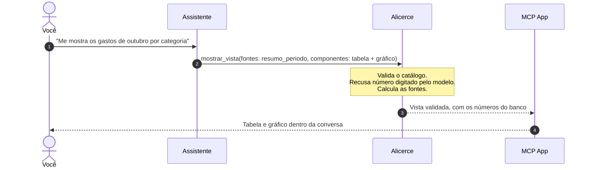
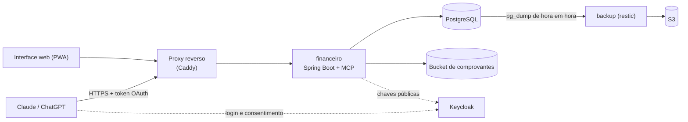
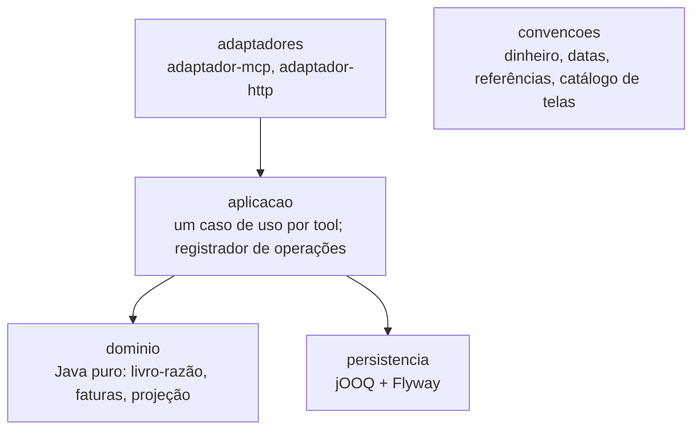

<div align="center">

# Alicerce Finanças

**Controle financeiro pessoal por conversa.**

Você fala com o Claude ou o ChatGPT. O Alicerce guarda os fatos e faz as contas,  
sem planilha, sem app novo e sem número inventado pela IA.

[](https://openjdk.org/projects/jdk/21/)
[](https://spring.io/projects/spring-boot)
[](https://modelcontextprotocol.io)
[](#rodando-o-build)
[](LICENSE)

</div>

---

> **Você:** Gastei 45 no almoço, no débito.\
> **Assistente:** Registrado: R$ 45,00 em Alimentação, na conta corrente.
>
> **Você:** Comprei uma TV de 2.400 em 10x no cartão.\
> **Assistente:** São 10 parcelas de R$ 240,00, a primeira na fatura de dezembro.
>
> **Você:** O que eu preciso cortar para fechar o mês no verde?\
> **Assistente:** Faltam R$ 312,40. O plano mínimo é cortar R$ 180,00 em Delivery e R$ 132,40 em Lazer.
>
> **Você:** Desfaz a TV.\
> **Assistente:** Desfeito. As 10 parcelas saíram das faturas, e o histórico guarda as duas operações.

---

## O que é o Alicerce?

O Alicerce é um servidor [MCP](https://modelcontextprotocol.io) que dá ao seu assistente de IA uma **memória financeira confiável**. Você registra gastos conversando, manda o print do Pix ou a foto da nota fiscal e faz perguntas sobre o seu dinheiro.

A divisão de trabalho é rígida:

- **O assistente pensa:** entende o que você disse, pergunta o que falta, interpreta e sugere.
- **O servidor registra, calcula e prova:** guarda cada fato num livro-razão contábil e devolve saldos, totais, projeções e cortes calculados de forma determinística.

Nenhum número sai do modelo. Quando o assistente diz que faltam R$ 312,40, esse valor veio de uma conta feita no banco de dados, e você pode abrir a tela que prova.

---

## Por que não uma planilha ou um app?

| Abordagem | Registra conversando | Números calculados, não estimados | Histórico imutável com desfazer | Você hospeda os dados |
|---|:---:|:---:|:---:|:---:|
| Planilha | ✗ | parcial | ✗ | ✓ |
| App de finanças | ✗ | ✓ | ✗ | ✗ |
| Chat de IA sozinho | ✓ | ✗ | ✗ | ✗ |
| **Alicerce** | ✓ | ✓ | ✓ | ✓ |

A IA é ótima para entender "gastei 45 no almoço" e péssima para somar 300 lançamentos. O Alicerce deixa cada um fazer o que faz bem.

---

## O que dá para fazer

| Você pede ou envia | O Alicerce faz |
|---|---|
| "Gastei 45 no almoço, débito", o print do Pix, a foto da nota | Registra o gasto padronizado, com itens e chave da NFC-e. Se faltar dado, pergunta em vez de chutar. |
| "Comprei em 10x no cartão" | Lança as parcelas nas faturas certas, pelo dia de fechamento e de vencimento do cartão |
| "Quanto gastei e quanto ganhei em setembro?" | Resumo de qualquer período, por competência ou por caixa |
| "Estou gastando mais rápido que o normal?" | Compara o ritmo do mês com o seu típico e mostra quais categorias puxam a diferença |
| "O que preciso cortar para fechar o mês no verde?" | Projeta o fim do mês e monta o plano mínimo de cortes por categoria |
| "Acha uma boa ideia comprar esse notebook?" | Simula a compra em cada forma de pagar e mostra o que ela faz com o saldo, a reserva, as parcelas e as metas ([veja abaixo](#acha-uma-boa-ideia-comprar-isso)) |
| "E se eu fizer essa viagem em março?" | Projeção mês a mês, com a linha de base e até três cenários |
| "Quero juntar 8 mil até julho" | Meta com conta reservada: quanto falta e quanto aportar por mês |
| "Minha reserva é de 6 meses de gastos" | Regras do perfil (reserva mínima, teto de parcelas, poupança) que o servidor vigia e avisa quando estão em risco |
| "O aluguel vence todo dia 10" | Compromissos a pagar e a receber, com a agenda do que vence |
| "O saldo do banco está 1.234,56" | Confere contra o livro-razão e aponta a diferença e os lançamentos candidatos |
| "Quanto gastei com a família este ano?" | Âmbitos (pessoal, família, igreja, empresa…) e um link de prestação de contas |
| "Desfaz isso." | Toda escrita é uma operação que pode ser desfeita, sem apagar nada ([veja abaixo](#desfazer-uma-operação-de-primeira-ordem)) |

Também lida com conta em moeda estrangeira (o câmbio entra como o extrato mostra) e com comprovantes e fotos anexados aos lançamentos.

---

## "Acha uma boa ideia comprar isso?"

É a pergunta em que a IA sozinha mais erra: ela responde com bom senso genérico, ou pior, com contas de cabeça. No Alicerce, **a opinião é do assistente, mas os fatos que a sustentam vêm do servidor.**

> **Você:** Acha uma boa ideia comprar esse notebook de 6.000? À vista ou em 10x?
>
> **Assistente:** Simulei as duas formas nos próximos 6 meses.
>
> - **À vista:** o saldo fica abaixo da sua reserva mínima de março a maio, mesmo na estimativa otimista.
> - **Em 10x:** a reserva se mantém, mas as parcelas chegam a 34% da renda em abril, acima do teto de 30% que você declarou.
>
> Nos dois casos, a meta da viagem atrasa de julho para setembro. Se puder esperar até maio, em 10x nenhuma regra sua é quebrada. A simulação ficou guardada como `s-4TQ8WD`.

O que o servidor entrega numa chamada de `projetar`:

- **Até três cenários lado a lado**, como à vista, em 10x ou só em maio. No crédito, cada parcela cai na fatura em que o cartão realmente a cobraria.
- **Duas estimativas, sempre:** a otimista (mediana dos seus gastos) e a pessimista de propósito (percentil 80), para a decisão não depender de um mês bom.
- **As suas regras, conferidas mês a mês:** reserva mínima, piso do período, teto de parcelas sobre a renda e metas protegidas. O assistente não interpreta as suas regras: o servidor diz quais o cenário quebra e quando.
- **O efeito nas metas:** a data em que cada meta seria alcançada em cada cenário, contra a data que você definiu.
- **Ressalvas honestas:** com menos de três meses de histórico ou com saldo sem conferência recente, a resposta avisa que a base é frágil, em vez de fingir certeza.
- **Um retrato imutável** da simulação. Semanas depois, "aquela simulação do notebook ainda vale?" compara o retrato com os dados de hoje.

> [!NOTE]
> O Alicerce não diz "compre" ou "não compre". Ele mostra o que a compra faz com o seu dinheiro e com as regras que **você** declarou. A recomendação fica com o assistente e a decisão, com você.

---

## Desfazer: uma operação de primeira ordem

> **Humanos erram devagar. IAs erram rápido.**

Quem digita numa planilha erra um lançamento de cada vez e costuma perceber na hora. Um assistente que entendeu errado "registra os gastos desse extrato" lança trinta gastos na conta errada em segundos. Num sistema operado por IA, desfazer não pode ser conveniência: tem de fazer parte da fundação.

Por isso, no Alicerce, desfazer não é um botão acrescentado depois. Ele decorre de como toda escrita é feita:

- **Toda escrita é uma operação registrada.** Cada escrita declara os efeitos que produz, e o registrador de operações guarda cada um. Não há escrita fora dele.
- **Desfaz uma operação ou o pedido inteiro.** As chamadas de um mesmo pedido formam um lote, e o lote se desfaz de uma vez: os trinta gastos do extrato saem juntos.
- **Prévia exata antes de confirmar.** O primeiro passo executa a reversão inteira e a cancela no fim. Assim mostra exatamente o que vai mudar e o que impediria a reversão, sem gravar nada. O segundo passo, depois do seu "sim" (o token vale 10 minutos), aplica a reversão e confere que o resultado é igual ao da prévia.
- **Desfazer não apaga.** Lançamentos viram estornos, estruturas voltam à versão anterior, e a trilha de auditoria guarda o erro e a correção. Desfazer um desfazer refaz.
- **Disponível fora da conversa.** Na interface web, desfazer é uma das duas únicas ações, com escopo próprio (`fin:undo`). Você corrige o que o assistente fez sem precisar pedir a ele.

---

## Interface web

A conversa é a porta de entrada, mas tudo o que o Alicerce guarda também pode ser visto. Como prevê o [artigo que fundamenta a arquitetura](#referência-teórica), a tela aqui serve à supervisão: você vê, audita e desfaz, e quem opera é o assistente.

Há duas formas de ver, e as duas usam o mesmo renderizador e o mesmo catálogo de componentes.

### Um link em cada resposta

Todo registro tem um endereço estável e curto, como `fin:t-8K3QZ2`. O assistente devolve o link junto com a resposta, e ele abre a tela do lançamento, da fatura, da conta, da meta ou do comprovante. Se você colar o link de volta na conversa ("explica esse gasto"), o assistente busca o registro pelo endereço e não confia na memória da conversa.

As telas cobrem contas, lançamentos, faturas, compromissos e agenda, relatórios, metas, comprovantes e a **trilha de auditoria**: cada operação, quem a fez (Claude, ChatGPT ou a própria interface) e as tentativas recusadas.

### Telas dentro da conversa

No Claude e no ChatGPT, as telas aparecem dentro do chat como **MCP App**. O assistente também pode montar uma tela sob medida para a sua pergunta, como um cartão com totais, uma tabela ou um gráfico, com a tool `mostrar_vista`.

A regra dos números vale aqui também: o assistente escolhe os componentes, mas **não digita nenhum valor**. Cada número entra como referência a um dado que o servidor calculou, e o servidor valida a tela antes de desenhá-la.



### Só leitura, por desenho

- **Login OIDC com PKCE.** O token de leitura fica só na memória da aba, nunca em armazenamento do navegador.
- **Duas ações, cada uma com o seu escopo.** A interface não registra nem edita nada. Ela só *desfaz* uma operação (`fin:undo`) e *pede um link de envio de comprovante* (`fin:attach`). No clique, cada ação pede um token só com o seu escopo, usa e descarta.
- **CSP sem `unsafe-inline`:** a página não executa script embutido.

### Para outras pessoas e para o celular

- **Prestação de contas:** um link que abre sem login e mostra só os gastos e entradas de um âmbito num período. Serve para a família, a igreja ou o sócio. Nada mais da sua conta aparece.
- **Envio de comprovante:** o assistente gera um link de uso único. Você abre no celular e manda a foto da nota ou o PDF do comprovante.
- **Instalável (PWA)**, com modo escuro e layout para celular.
- **Acessível:** cada tela passa por testes automáticos de WCAG AA num navegador real.

---

## Por que confiar nos números

- **Livro-razão de partidas dobradas, imutável.** Todo lançamento soma zero dentro de cada moeda, e o banco confere isso no commit. Corrigir vira estorno: nada é editado nem apagado.
- **Dinheiro como dinheiro.** `BigDecimal` com duas casas no domínio e centavos inteiros no banco. Nunca `double`.
- **Desfazer de verdade.** Toda escrita pode ser revertida, com prévia exata e sem apagar nada ([veja acima](#desfazer-uma-operação-de-primeira-ordem)).
- **Idempotência.** Se o assistente repetir uma chamada (acontece!), o gasto não entra duas vezes.
- **Recusa em vez de chute.** Faltou a conta ou o valor? A tool devolve `campos_faltando` e o assistente pergunta.

---

## Privacidade e segurança

- **OAuth 2.1**, como pede a especificação do MCP, com Keycloak. O servidor publica os metadados do recurso (RFC 9728) e confere, em cada chamada, assinatura, emissor, audiência, validade, cliente, papel do dono e escopo da tool.
- **Escopos separados:** ler (`fin:read`), registrar (`fin:write`), estrutura (`fin:structure`), perfil (`fin:profile`) e compartilhar (`fin:share`). O assistente só faz o que você autorizou.
- **As tools nunca veem o token**, só o dono e os escopos já validados.
- **Comprovantes num bucket privado**, com links de uso único.
- **Backup criptografado** de hora em hora (restic + S3), com restauração verificada automaticamente todo mês.

---

## As tools

| Grupo | Tools |
|---|---|
| Para começar | `guia`, `obter_contexto`, `resolver_referencia` |
| Registrar | `registrar_gasto`, `registrar_ganho`, `registrar_transferencia`, `corrigir_lancamento`, `anexar_comprovante`, `desfazer` |
| Estrutura | `definir_conta`, `definir_meio_pagamento`, `definir_ambito` |
| Perfil e planos | `declarar`, `definir_meta`, `definir_compromisso`, `resolver_ocorrencia` |
| Consultar | `listar_lancamentos`, `listar_operacoes`, `listar_compromissos`, `obter_agenda`, `obter_fatura`, `conferir_saldo` |
| Analisar | `situacao`, `resumo_periodo`, `ritmo_gastos`, `cortes_necessarios`, `projetar` |
| Mostrar e compartilhar | `mostrar_vista`, `prestar_contas` |

Os nomes falam da intenção (`registrar_gasto`), não da tabela (`create_transaction`), como propõe a [referência teórica](#referência-teórica) do projeto.

---

## Referência teórica

A arquitetura e o paradigma de interface do Alicerce seguem o artigo:

> Shaolin Wang, Yi Mei, Haoyang Che, He Jiang, Shui Yu e Ying Gu.\
> **[From Human Interfaces to Agent Interfaces: Rethinking Software Design in the Age of AI-Native Systems](https://arxiv.org/abs/2603.20300).**\
> arXiv:2603.20300, março de 2026.

O trabalho é de pesquisadores do Geely Holding Group e da Dalian University of Technology, na China, com a Victoria University of Wellington, na Nova Zelândia. A tese: o software está passando da *interação guiada pela percepção* (telas, formulários, fluxos) para a *execução guiada por invocação*. Nela, agentes de IA escolhem e combinam **capacidades invocáveis**, e a unidade básica do software deixa de ser a funcionalidade e passa a ser a capacidade.

O artigo propõe cinco princípios, que aqui viram regras concretas:

| Princípio do artigo | Como aparece no Alicerce |
|---|---|
| Interpretabilidade por máquina | Tools nomeadas pela intenção, parâmetros tipados, enums fechados e descrições curtas com exemplo |
| Capacidades combináveis | Tools pequenas e independentes que o assistente encadeia: registrar, consultar, projetar, mostrar. Nenhuma tool genérica do tipo `executar(entidade, operacao, parametros)`. |
| Contratos explícitos | Toda tool documenta entrada, saída, efeitos, modos de falha e escopo exigido. Dado faltando volta como `campos_faltando`. |
| Confiabilidade de invocação | Idempotência nas escritas (repetir é seguro), erros tipados, livro-razão imutável e desfazer em dois passos |
| Compatibilidade com o contexto | Saídas compactas. `guia` e `obter_contexto` entregam os conceitos e a estrutura de uma vez. |

Mais duas ideias do artigo moldam o projeto:

- **A tela vira supervisão.** As interfaces gráficas continuam importantes, mas como interface secundária, para supervisão, depuração e tratamento de exceções. É o papel da [interface web](#interface-web): ver, auditar e desfazer, não operar.
- **Público duplo.** Sistemas reais servem humanos e IAs ao mesmo tempo. Aqui, a mesma vista validada é desenhada no navegador para você e dentro da conversa pelo assistente.

Uma regra vai além do artigo e é própria do projeto: **números nunca saem do modelo**.

---

## Arquitetura



Cada módulo tem camadas, e o ArchUnit confere as regras em todo build:



**Stack:** Java 21 · Spring Boot 4.1 · Spring AI 2.0 (SDK Java do MCP, Streamable HTTP) · Spring Security 7.1 · PostgreSQL 16 · Flyway · jOOQ · Gradle · JUnit · Testcontainers (Postgres, Keycloak, MinIO, Chromium) · ArchUnit · Selenium + axe · Docker Compose · Caddy · restic

```text
plataforma/
  convencoes/      convenções compartilhadas (Java puro) e o renderizador de telas
  seguranca/       validação de token, escopos e dono
  financeiro/      dominio, aplicacao, adaptador-mcp, adaptador-http, persistencia, app
  infra/           docker-compose, Caddy, realm do Keycloak, comprovantes, backup, publicação
AGENTS.md          regras de código (para pessoas e agentes de IA)
```

---

## Rodando o build

Só é preciso Docker. Nada de JDK ou Gradle no host:

```bash
# Compila com -Werror, roda ArchUnit e os 524 testes com Testcontainers
plataforma/ci.sh build

# Uma tarefa específica do Gradle
plataforma/ci.sh :financeiro:dominio:test
```

> 524 testes. O build completo leva de 10 a 20 minutos, porque sobe Postgres, Keycloak, MinIO e um navegador real.

---

## Hospedando a sua instância

> [!NOTE]
> O Alicerce nasceu para uso pessoal e roda em produção, no dia a dia do autor. Ele **ainda não é um produto de instalar com um clique**. Se travar em algum passo, abra uma issue: isso ajuda a simplificar o caminho.

1. **Domínio** com dois endereços: um para o MCP (`fin.seudominio.com`) e outro para a interface (`app.seudominio.com`).
2. **Keycloak** com o realm de `plataforma/infra/keycloak/realm-alicerce.json`, ajustando endereços e audiências. O seu usuário precisa do papel `fin-owner`.
3. **Endereços** em `application.yaml` (ou por variável de ambiente): `alicerce.seguranca.emissor`, `alicerce.seguranca.recurso` e `alicerce.financeiro.endereco-web`. Ajuste também os hosts do `Caddyfile`.
4. **Segredos e subida:** copie os `*.env.exemplo` para `.env`, preencha as senhas e rode:

   ```bash
   cd plataforma/infra && docker compose up -d --build
   ```

5. **Opcional:** o bucket de comprovantes (`infra/comprovantes/provisionar-aws.sh`) e o backup (`infra/backup/`).

Por fim, adicione `https://fin.seudominio.com/mcp` como conector personalizado no Claude ou no ChatGPT.

---

## Princípios

Cinco ideias por trás de cada decisão:

1. **O assistente pensa; o servidor registra, calcula e prova.** Nenhum número sai do modelo.
2. **Todo erro tem volta, e nada se apaga.** A IA erra rápido, então desfazer é parte da fundação: corrigir é estornar, desfazer é registrar o inverso, e o histórico conta tudo.
3. **Recusar é melhor que adivinhar.** Dado faltando volta como pergunta, não como suposição.
4. **Tudo tem endereço.** Um link estável leva da conversa ao registro e do registro à operação que o criou.
5. **Seus dados, seu servidor.** Escopos mínimos, token fora das tools e backup que você pode restaurar.

---

## Contribuindo

Issues e pull requests são bem-vindos. Antes de mexer no código, leia o [AGENTS.md](AGENTS.md): ele traz as regras de arquitetura e de negócio que o build confere e os arquivos de referência para cada tipo de mudança. Os nomes no código são em português, de propósito.

---

## Licença

[GNU Affero General Public License v3.0](LICENSE). Você pode usar, estudar, modificar e redistribuir. Se oferecer uma versão modificada como serviço na internet, precisa disponibilizar o código-fonte dessa versão a quem usa.
